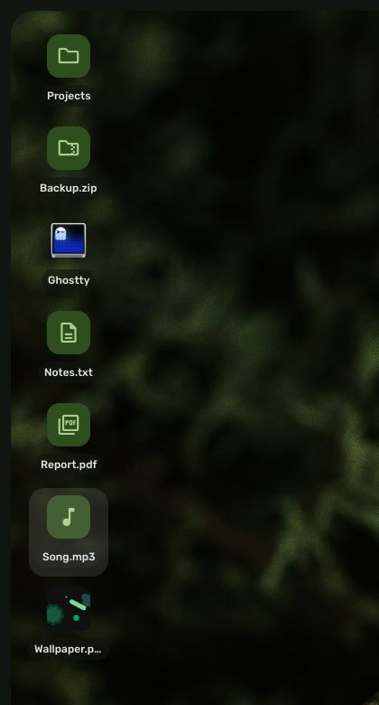

# blxshell plugins

The official pool of plugins and themes for [blxshell](https://github.com/binarylinuxx/dots).
Everything here is reviewed before it's merged.


| | Plugin | |
|---|---|---|
|  | [System monitor](plugins/dev.blxshell.sysmon) | CPU, memory or temperature, with a usage ring that turns red past a threshold |
|  | [Network speed](plugins/dev.blxshell.netspeed) | Live download and upload rates of the active connection |
|  | [Pomodoro](plugins/dev.blxshell.pomodoro) | A focus timer with breaks, a countdown ring and notifications |
|  | [Desktop icons](plugins/dev.blxshell.desktop) | The files in your desktop folder as icons on the wallpaper, each with a popup of actions |
|  | [Lock screen widgets](plugins/dev.blxshell.lockscreen) | A greeting, a message card, a calendar, a countdown and system info, placed with the lock screen layout editor |
|  | [Glassify](plugins/dev.blxshell.glassify) | The whole lock screen as liquid glass: real refraction through rounded edges, no highlights |

## Installing

Every package here is built in CI and published to the
[`packages` release](https://github.com/binarylinuxx/dots-plugins/releases/tag/packages),
so blxshell installs them prebuilt:

```sh
blxshell search
blxshell install dev.blxshell.pomodoro
blxshell update
```

Then turn it on in **Settings → Plugins**, and place its module in the bar
from the same page.

## Using them

**System monitor**: scroll to switch between CPU, memory and temperature; click
for the detail (load average, GiB used, °F); right click opens the dashboard.
`blxshell plugin call dev.blxshell.sysmon memory` switches from a keybind.

**Network speed**: click or scroll to show both directions, download only or
upload only; right click switches between bytes and bits. Leave the interface
empty to follow the default route.

**Pomodoro**: click to start or pause, right click to skip to the next phase,
middle click to reset, scroll while stopped to change the focus length. For a
keybind: `blxshell plugin call dev.blxshell.pomodoro toggle` (also `start`,
`pause`, `skip`, `reset`).

**Desktop icons**: shows what's in your desktop folder (`~/Desktop`, or any
folder set in its settings) on the wallpaper, with file-type icons, image
thumbnails and app launchers. Click an icon for its actions: Open, Open with
another app, Show in folder, Copy path, Move to trash (Run for launchers).
Double-click opens it. Needs a blxshell with desktop item support.

**Lock screen widgets**: add them in the lock screen's layout editor
(**Settings → Lock screen → Edit layout → Add**), then drag and resize them
like the clock. Their texts, the countdown's date and the calendar's first
weekday are set in **Settings → Plugins**.

Each one draws itself in Facet (`plugin.facet`) on a small Python backend
using only the standard library. Their READMEs list the controls.

## Layout

```text
list.json                        what this repository offers
plugins/<id>/                    one folder per plugin: what its .blx holds
  manifest.json
  screenshot.png
  bin/…
themes/<id>/                     one folder per theme
schema/manifest.schema.json      the manifest format (from blxshell)
tools/validate.py                the checks CI runs
tools/build.py                   builds every package into build/ with index.json
```

`list.json` lists each package's `id` and `path`. Everything else comes from
the package's own `manifest.json`. The format is described on the
[wiki](https://bshell.zapzig.org/plugins/discover/).

## Writing a plugin

A plugin draws its UI in [Facet](https://github.com/binarylinuxx/vw/tree/main/facet):
views named `Bar…` are bar modules and a `Settings` view is its page in the
settings app. A process in any language can sit behind the views, and C++ is
possible when Facet isn't enough. The manifest only says who it is and what it
may do. The full reference is blxshell's
[docs/packages.md](https://github.com/binarylinuxx/dots/blob/main/docs/packages.md);
the four plugins here are working examples.

## Submitting a plugin or theme

1. Fork, then add your folder under `plugins/` or `themes/`, named after its id
   (reverse-DNS, e.g. `io.github.you.weather`).
2. Add it to `list.json`.
3. For a plugin, include a `screenshot.png` of it in the bar and list it in
   `previews`, or draw a simple one: `python3 tools/thumbnail.py plugins/<id>`
   (`--style layers` for wallpapers).
4. Run the checks, and pack it once to be sure blxshell reads it:

   ```sh
   python3 tools/validate.py
   blxshell pack plugins/io.github.you.weather
   ```

5. Open a pull request. Once it's merged, CI builds it and `blxshell install <id>`
   gets it.

### Compiled plugins

No compiled binaries are accepted: not executables, libraries, object files,
WebAssembly, or archives that could hold them. CI refuses them. A plugin
written in a compiled language commits its **source** and a **`build.sh`**,
and only CI builds it:

```text
plugins/io.github.you.weather/
├── manifest.json        "exec": ["bin/weather"]
├── screenshot.png
├── build.sh             builds into bin/ (must be executable)
└── src/…
```

- `build.sh` runs from the package folder on GitHub's `ubuntu-latest`
  runner, in a throwaway copy, with `bash -euo pipefail`.
- What it puts in `bin/` goes into the package, next to the committed files.
  Anything else it leaves behind is dropped.
- The program named in `exec` must exist and be executable afterwards.

Try it locally with `python3 tools/build.py`. This way the code reviewers read
is the code users run, and no one can slip a binary past review.

Reviewers look at:

- **Permissions**: does it ask only for what it uses? `shell` and
  `notifications` are enforced by blxshell; the rest are declarations users rely
  on, so they must be truthful.
- **Compiled plugins**: the source and `build.sh` get the same reading as any
  plugin code; the build must not download and run anything unpinned.
- **The code**: a plugin runs as the user. No obfuscated or minified code, no
  downloading and running code at runtime, and no network access unless
  declared and needed.
- **Behaviour**: it exits when stdin closes, doesn't spin the CPU, and survives
  a missing sensor, file or connection without crashing.
- **Compositors**: `"any"` only if it really works everywhere.

Updates go through a pull request too: change the folder and bump `version`.

## Custom repositories

Anyone can publish a repository with this layout. Packages from repositories
other than this one aren't reviewed by the blxshell maintainers.

## License

Each package states its own license in its manifest. The three plugins here
are MIT.
